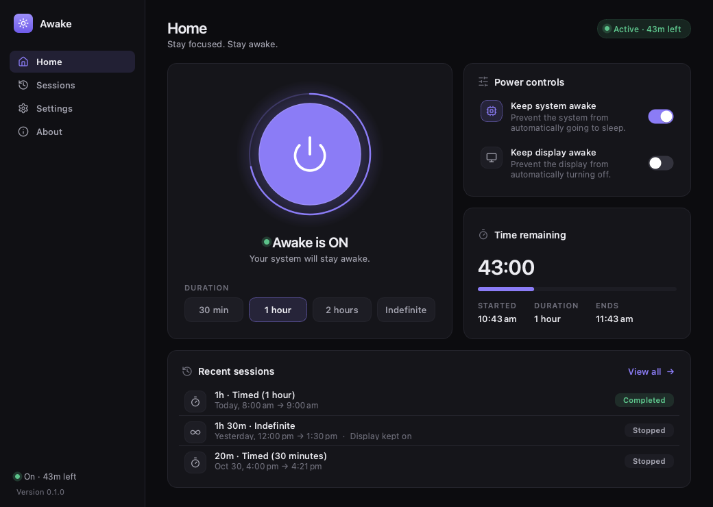
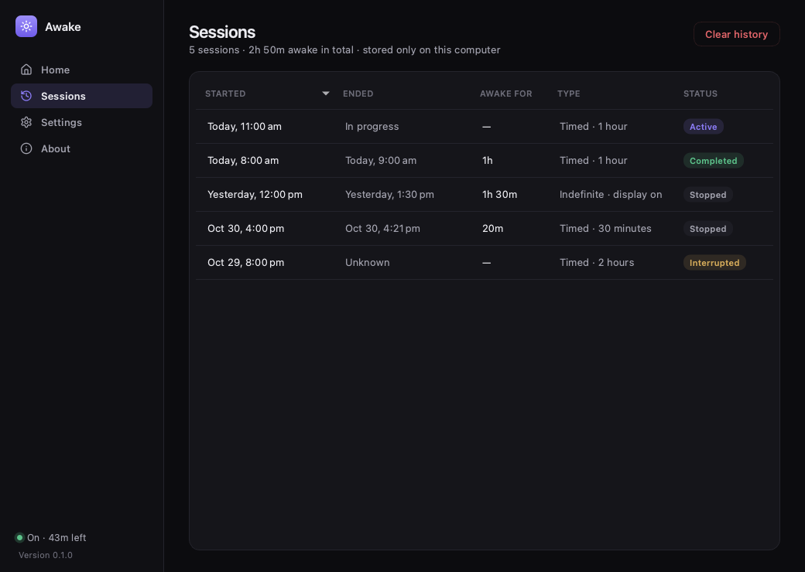
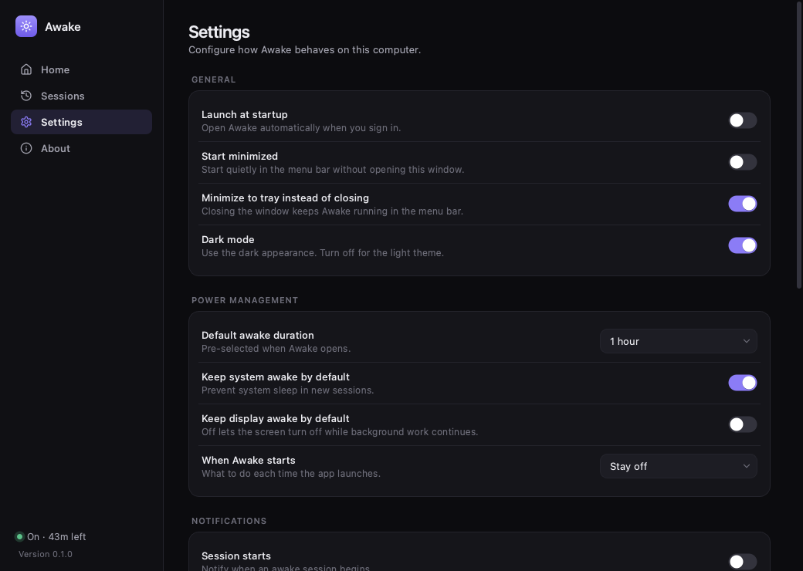
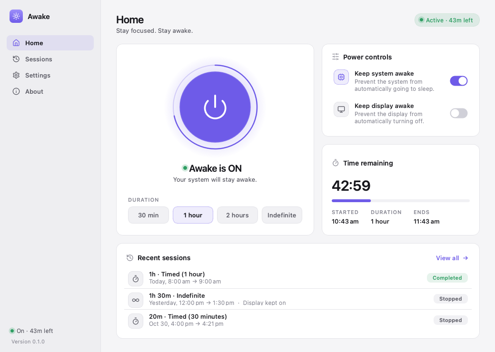

# Awake

**Stay focused. Stay awake.**

Awake is a lightweight desktop utility that keeps your computer from going to sleep while you work. One click keeps the system awake for 30 minutes, 1 hour, 2 hours or indefinitely; the display can independently be allowed to turn off, so long-running work continues while the screen sleeps.

macOS and Windows, one Python codebase, fully offline, no account, no telemetry.



| Sessions | Settings | Light theme |
|---|---|---|
|  |  |  |

## Download

Get the latest build from **[Releases](https://github.com/vampirepapi/awake/releases/latest)**:

- macOS: `…-macOS-arm64.dmg` (Apple silicon) or `…-macOS-x86_64.dmg` (Intel)
- Windows 10/11: `…-Setup.exe` (installer, no admin rights needed) or `…-Windows-x64-portable.zip`

Builds are not code-signed yet, so macOS and Windows warn on first launch. The release notes explain how to open them.

## Features

- **One-click power button** — only turns on after the operating system confirms the power request.
- **Timed or indefinite sessions** — 30 min / 1 h / 2 h / Indefinite, with live countdown, progress and end time. Changing the duration of a running session restarts the countdown from now.
- **Independent controls** — *Keep system awake* (default on) and *Keep display awake* (default off), both changeable mid-session.
- **Keeps awake while AI agents work (new in 0.2)** — detects when Claude Code is working (via its official `claude agents --json` status) and keeps the *system* awake until it finishes, then lets the machine sleep normally after a 60-second grace period. Pauses on battery below 20 %, gives up after 4 hours of continuous work, never reads prompts or output. On by default; turn it off in Settings › AI agents or from the menu bar. See [docs/AGENT_DETECTION.md](docs/AGENT_DETECTION.md).
- **Menu bar countdown (macOS)** — while Awake is on, the time left (`1h 59m` … `1m`) or `∞` sits next to the menu-bar icon; updated once a minute, can be turned off in Settings.
- **Menu bar / system tray** — status, start/stop, durations, power toggles, open, settings, quit. Closing the window keeps Awake running; the macOS Dock icon is hidden while the window is closed.
- **Session history** — stored in SQLite, sortable, with completed / stopped / interrupted status and a confirmed *Clear history*.
- **Settings** — launch at sign-in, start minimized, close-to-tray, dark/light theme, default duration and power options, behaviour at launch, notifications.
- **Safe cleanup** — quitting releases every request; if Awake crashes or is force-killed the OS drops its requests automatically, and the orphaned session is marked *Interrupted* on next launch.

## Verification status

Honest status of what has been verified, and how:

| Area | macOS (Apple silicon, macOS 26.5) | Windows 10/11 |
|---|---|---|
| Automated tests | ✅ 78 mocked + 2 native IOKit tests pass | ✅ 78 mocked tests pass on GitHub's Windows runner |
| Native power API on real OS | ✅ `pmset -g assertions` shows `PreventUserIdleSystemSleep named: "Awake"`; no display assertion unless enabled; released on stop, quit, SIGTERM and `kill -9` | ⚠️ Real `SetThreadExecutionState` calls succeed on GitHub's Windows runner (`tests/test_native_windows.py`, with `powercfg /requests` confirmation). **Not yet tested by hand on a Windows 10/11 PC** |
| Packaged app | ✅ `Awake.app` + DMG built and launched; session, single-instance handoff, AppleScript (Cmd+Q path) quit, and Dock hiding (`lsappinfo`: `UIElement` while in the menu bar, `Foreground` with the window open) verified | ⚠️ `Awake.exe` and the Setup installer are built by CI; not yet launched on a Windows desktop |
| Menu bar / tray | ✅ Tray icon created (`tray_shown available=True`); menu logic covered by offscreen tests. Clicking through the real menu bar was **not** automated | ❌ Not verified |
| Notifications | ⚠️ Implemented via `QSystemTrayIcon.showMessage`; not visually confirmed | ❌ Not verified |
| AI-agent detection (Claude Code) | ✅ Live on a real Mac: detected 3 busy Claude Code sessions within 0.5 s and held a system-only assertion; turning AI mode off released instantly and on re-acquired in 0.1 s. Automatic release after all sessions go idle is unit-tested but not yet observed live | ⚠️ On GitHub's Windows runner: `claude agents --json` works (Claude Code 2.1.316) and Awake recognises a running `claude.exe` and builds the right command. Not yet tried with a real working session on a Windows PC |
| Launch at startup | ⚠️ LaunchAgent plist generation unit-tested; a real login cycle was not performed | ⚠️ Run-key logic unit-tested with a fake registry |

### Measured performance (macOS, packaged `Awake.app`, session active, window hidden)

| Metric | Target | Measured |
|---|---|---|
| Idle CPU (20–30 s average) | < 1 % | **0.01–0.03 %** (max 0.6 %) |
| Memory | < 100 MB | **54–57 MB** physical footprint (Activity Monitor “Memory”); RSS 138–142 MB including shared system frameworks |
| Startup (process start → event loop) | < 2 s | **0.18–0.26 s** warm; 2.5 s on the very first cold launch from source |
| Background wake-ups | minimal | 1 Hz UI tick only while a session is active *and* the dashboard is visible; otherwise one expiry check per minute |

Reproduce with `python scripts/measure_performance.py <pid>`; startup time is logged as `event=startup_complete`.

## Run from source

Requires Python 3.12+.

```bash
python3.12 -m venv .venv
.venv/bin/pip install -r requirements-dev.txt     # Windows: .venv\Scripts\pip ...
.venv/bin/python main.py
```

Tests:

```bash
.venv/bin/python -m pytest              # all tests; on macOS this briefly creates real IOKit assertions (native tests)
.venv/bin/python -m pytest -m native    # only the real-OS power tests
```

Data lives in `~/Library/Application Support/Awake` (macOS) or `%APPDATA%\Awake` (Windows): `awake.db` and `logs/awake.log`. Set `AWAKE_DATA_DIR` to use a different folder.

> Notifications from a bare `python main.py` on macOS may not appear because the interpreter has no app bundle identity; they are intended for the packaged `Awake.app`.

## Build installers

Each platform must be built on that platform — PyInstaller does not cross-compile.

| Platform | Command | Output |
|---|---|---|
| macOS | `scripts/build_macos.sh` | `dist/Awake.app`, `dist/Awake-<version>-macOS-<arch>.dmg` |
| Windows | `scripts\build_windows.bat` | `dist\Awake\Awake.exe`, `dist\Awake-<version>-Setup.exe` (with [Inno Setup 6](https://jrsoftware.org/isinfo.php)) |

GitHub Actions (`.github/workflows/build-macos.yml`, `build-windows.yml`) run the tests, the native power tests and the packaging on each platform for every push.

To publish a release, bump `__version__` in `awake/__init__.py`, commit, then tag:

```bash
git tag v0.2.0 && git push origin v0.2.0
```

`.github/workflows/release.yml` checks the tag matches the version, builds macOS (arm64 + Intel) and Windows, and publishes a GitHub Release with the DMGs, the Windows installer, a portable zip and `SHA256SUMS.txt`, using `packaging/RELEASE_NOTES.md` as the description.

Release builds need code signing and notarization — see [docs/RELEASING.md](docs/RELEASING.md).

## How it works

```
UI (Qt Widgets) ──► ApplicationState ──► SessionManager ──► PowerManager ──► PowerBackend
 dashboard, tray      shared selection     lifecycle, timer,   owner-based       macOS: IOKit assertions
 settings, history    + error reporting    SQLite history      request union     Windows: SetThreadExecutionState
```

- **macOS:** `IOPMAssertionCreateWithName` (`PreventUserIdleSystemSleep` / `PreventUserIdleDisplaySleep`) via `ctypes`. Chosen over spawning `caffeinate` because the kernel releases assertions when the process dies, so nothing can be orphaned.
- **Windows:** `SetThreadExecutionState(ES_CONTINUOUS | ES_SYSTEM_REQUIRED [| ES_DISPLAY_REQUIRED])` on a dedicated long-lived worker thread (execution state is per-thread). No admin rights.
- Keeping the **display** awake implies keeping the **system** awake on both OSes; the reverse is not true, which is what lets the screen turn off while work continues.
- No synthetic input, mouse jiggling or CPU load is used.

See [docs/ARCHITECTURE.md](docs/ARCHITECTURE.md) for details, including how a future AgentMonitor (Claude Code, Codex, OpenCode, Cursor) plugs in without touching the power layer.

## Deviations from the original brief

- `platform/` is named `awake/platforms/` — a top-level `platform` package shadows Python's standard library module and breaks PySide6/PyInstaller.
- The stylesheet is one template (`awake/ui/styles/awake.qss`) rendered with dark and light palettes instead of a single `dark.qss`, because the *Dark mode* setting requires a light theme.
- `sessions` has an extra `system_awake` column (what the session kept awake is part of its history).
- `psutil` is a runtime dependency (since 0.2) for agent detection: listing processes and reading the battery state.
- Both power toggles off is not a valid session: starting is refused with a message, and switching the last one off mid-session ends the session.

## Privacy

Everything is stored locally. Awake makes no network requests, has no account and collects no telemetry. Logs contain only operational events (session start/stop, errors) — never user content.

## License

MIT — see [LICENSE](LICENSE). Third-party components (Qt for Python under LGPLv3, Lucide icons under ISC) are listed in [THIRD_PARTY_NOTICES.md](THIRD_PARTY_NOTICES.md).
